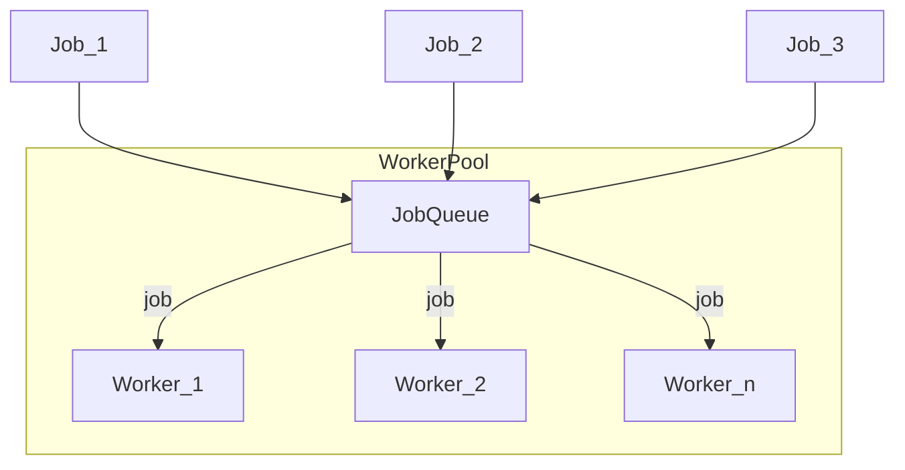
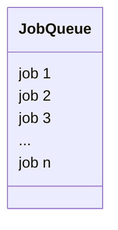
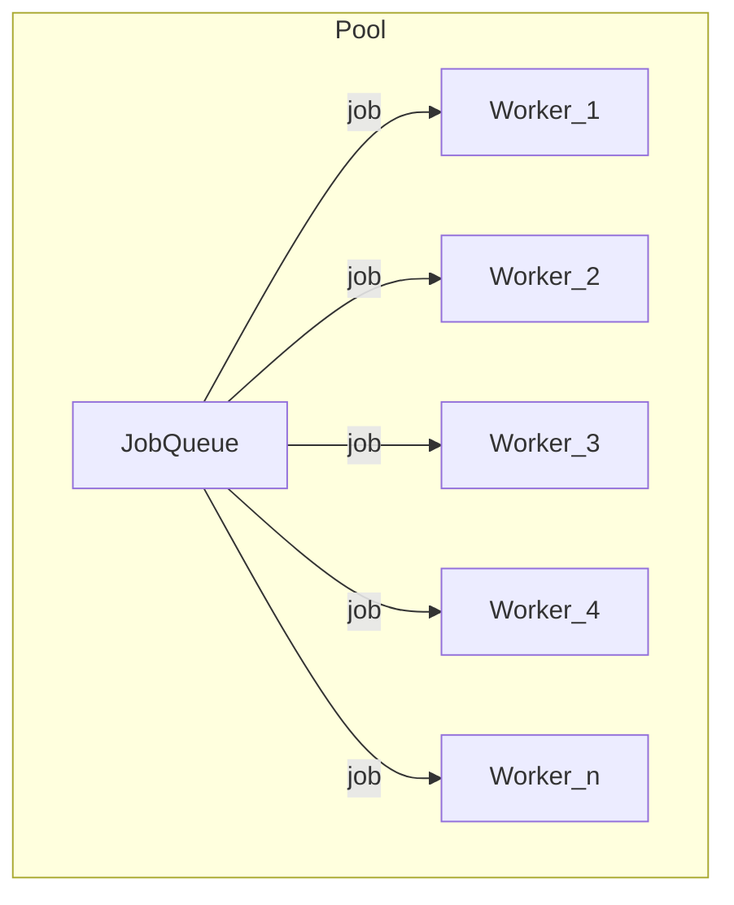
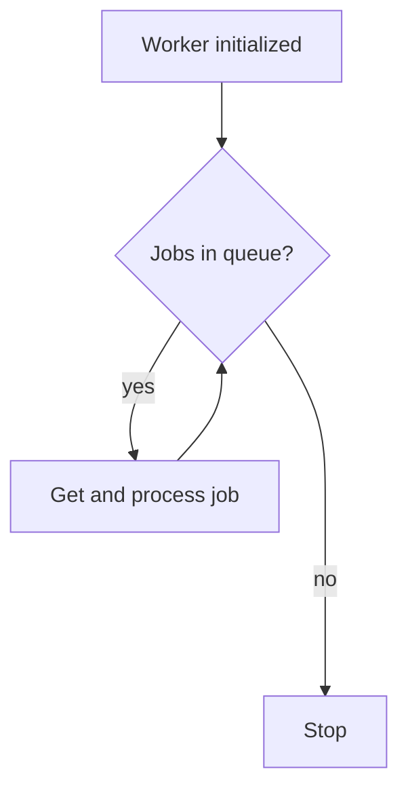
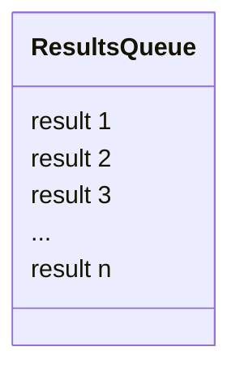

---
aliases:
- /en/go-introduction-to-goroutines-and-concurrency/explanation-of-worker-pool-design-pattern/
- /go-use-of-channels-to-communicate-goroutines/explanation-of-worker-pool-design-pattern/
- /en/worker-pool-design-pattern-explanation/
- /en/software-architecture/worker-pool-design-pattern-explanation/
authors:
- Eduardo Zepeda
categories:
- software architecture
- go
coverImage: images/worker-pool-patron.jpg
date: '2023-06-28'
seo_title: "Worker Pool Pattern in Go: Concurrency Guide"
description: Gain a much better understanding of the worker pool pattern by using this interactive, real-time simulator; play around with the parameters and see how a queue is dispatched visually
keywords:
- Go
- Design patterns
- Worker pool
- Concurrency
- Parallelism
- Workers
- algorithms
title: "Worker Pool Design Pattern: Interactive Playground"
---

I expanded this post with an interactive, real-time visual simulator to help you understand the worker pool design pattern. You can adjust parameters like the number of workers and failure rate to see how a queue is processed.

A worker pool helps when you need to run many concurrent tasks - like crawling websites, processing image pixels, or handling jobs in bulk.

The simple approach is to spawn a worker per job:

```python
for job in jobs:
    async process_concurrent_job()
```





This works for small cases, but has problems: it creates workers without limit (memory grows fast), and constantly creating/destroying workers is expensive.



The worker pool pattern fixes this by keeping a fixed number of workers and reusing them.

## Interactive worker pool

The worker pool is a classic [design pattern](). 



This pattern has been used to [handle a million requests per minute in Go](http://marcio.io/2015/07/handling-1-million-requests-per-minute-with-golang).



## How it works

Create a fixed number of workers ([goroutines in Go](/en/go/go-introduction-to-goroutines-and-concurrency/)) and have them pull jobs from a queue (using [channels in Go](/en/go/go-use-of-channels-to-communicate-goroutines/)). Workers stay alive and reuse themselves, keeping memory usage stable and avoiding constant creation/destruction. Optionally, collect results in a separate queue.





### Job queue

Jobs go into a queue - can be fixed or created dynamically.



### Worker pool

A fixed number of workers pull jobs from the queue. Each takes a job, runs it, and goes back for the next one.





### Worker

A worker loops: get a job if available, process it, repeat until the queue is empty or a stop condition is met.



A fixed pool caps how many tasks run at the same time, keeping resource usage predictable.

### Results queue (optional)

Workers can push results to a separate queue for later processing.



This pattern is common in languages with strong concurrency support like [Go]() and is useful for processing large batches of work without overwhelming the system.