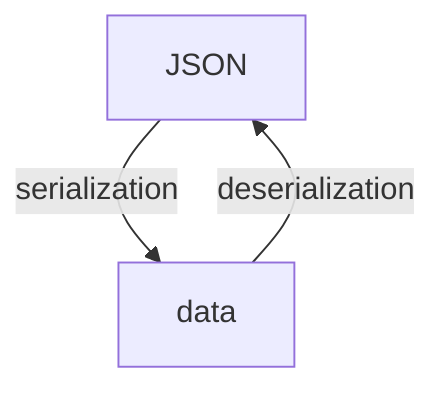
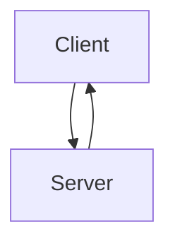
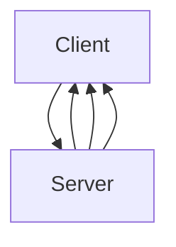
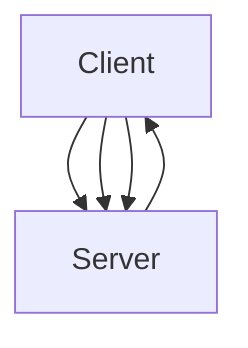
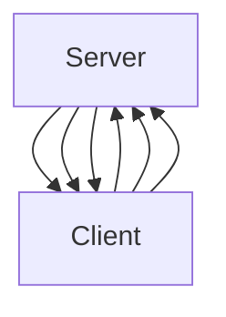

---
aliases:
- /en/unleash-your-apis-potential-with-grpc-and-protobuffers/
- /en/fast-and-performant-apis-using-grpc-and-protobuffers/
- /en/software-architecture/fast-and-performant-apis-using-grpc-and-protobuffers/
authors:
- Eduardo Zepeda
categories:
- software architecture
- go
coverImage: images/que-es-grpc-y-protobuffers.jpg
date: '2023-01-19'
seo_title: "What is gRPC and Protobuffers? Beginner's Guide"
description: Explanation of gRPC and protobuffers, advantages over JSON, why they're fast
  and how to create your first API with this protocol.
keywords:
- REST
- software architecture
- API
- best practices
title: Fast and performant APIs using Go Lang gRPC and Protobuffers
---

Protocol Buffers let you build faster Go gRPC APIs by serializing data in binary instead of formats like JSON. This post covers gRPC, Protocol Buffers (protobuf), and why they're faster than REST.

In [basic characteristics of a REST API]() I mentioned other API styles. gRPC is based on RPC, so let's start there.

## What is RPC?





RPC (Remote Procedure Call) lets you call code on a remote machine as if it were local.

### How RPC works

1. The client calls a procedure and the stub [marshals](https://en.wikipedia.org/wiki/Marshalling_(computer_science)) the request into a format for transport.
2. The request goes over the network to the server.
3. The server's stub unmarshals it, executes the procedure, and marshals the response.
4. The response returns to the client and is unmarshaled.



Traditional RPC requires both client and server to use the same language, which limits interoperability.



## What is gRPC?

Google improved RPC with gRPC. It still follows the RPC model but works across different languages. To serialize data efficiently, Google created Protocol Buffers (protobuf) as gRPC's default serialization format.



## What are Protocol Buffers?

APIs exchange data between client and server. That data needs to be serialized (converted to a transmittable format) and deserialized (converted back). JSON and XML are common, but they're text-based and less efficient.

Protocol Buffers are language- and platform-agnostic. gRPC uses them to serialize structured data to binary, making it smaller and faster to process than JSON or XML.







### How protobuf works

Define your messages and services in a `.proto` file:

```proto
message DataResponse {
    int32 id = 1;
    string info = 2;
    string result = 3;
}

message DataRequest {
    int32 id = 1;
    string info = 2;
}

service Publisher {
    rpc ProcessData (DataRequest) returns (DataResponse) {}
}
```

Then compile it with `protoc` to generate code for serialization/deserialization in your target language (C#, C++, Go, Java, Python, Ruby, etc.). You don't write marshaling code yourself.

### How to convert information with Golang protobuffers?

Simplifying, to create the necessary code to serialize and deserialize in the protobuffers format we start from a file with extension _.proto_, this will be in charge of modeling the information that we will use to communicate, as well as the services that will be available for our API. Basically it is to tell you how our information is structured and what changes we are going to make on this information along with what they will receive as input and return as response.

``` go
message DataResponse {
    int32 id = 1;
    string info = 2;
    string result = 3;
}

message DataRequest {
    int32 id = 1;
    string info = 2;
}

service Publisher {
    rpc ProcessData (DataRequest) returns (DataResponse) {}
}
```

After defining our models and services, these files are compiled, and will generate the necessary code to serialize and deserialize the information in the language we want, both on the client and server side. We do not have to worry about the details in this regard.

Currently the [protobuffers format is available for C#, C++, Go, Objective-C, Java, Python and Ruby.](https://developers.google.com/protocol-buffers) Check the documentation for your particular language.

## REST vs gRPC

| Aspect | REST (JSON/HTTP) | gRPC (Protobuf/HTTP/2) |
| --- | --- | --- |
| Speed | Slower (text-based) | Faster (binary) |
| Payload size | Larger | Smaller |
| Schema | Optional (OpenAPI) | Required (.proto) |
| HTTP version | HTTP/1.1 mostly | HTTP/2 |
| Streaming | Limited | Native (unary, client, server, bidirectional) |
| Browser support | Full | Limited (needs gRPC-Web) |
| Code generation | Optional | Built-in with protoc |
| Error handling | HTTP status codes | gRPC status codes |
| Caching | Easy | Harder |
| Human readable | Yes | No |

### Performance

Based on [Matthew Leung's comparison](https://medium.com/@EmperorRXF/evaluating-performance-of-rest-vs-grpc-1b8bdf0b22da):

| Metric | gRPC | REST |
| --- | --- | --- |
| Requests/sec | 48.00 | 4.00 |
| Request latency | 6.15 | 8.00 |
| CPU ms/s | 832.00 | 404.00 |
| CPU/request | 17.33 | 101.11 |

gRPC is typically 5-10x faster than JSON-based REST.

### Why is gRPC faster?

- **Binary serialization**: Protobuf is smaller and faster to parse than JSON
- **HTTP/2 multiplexing**: Multiple requests/responses over one TCP connection
- **Header compression**: Less overhead per request

## gRPC streaming types

gRPC supports four communication patterns:

- **Unary**: Single request, single response (like REST)


- **Server streaming**: Single request, multiple responses


- **Client streaming**: Multiple requests, single response (used in [MCP]())


- **Bidirectional streaming**: Multiple requests and responses


These are useful for microservices and real-time communication.

## Other gRPC features

- **Interceptors**: Middleware-like hooks to inspect or modify requests/responses
- **Load balancing**: Built-in support for distributing traffic

## References

- [How RPC works](https://learn.microsoft.com/en-us/windows/win32/rpc/how-rpc-works)
- [What's RPC - an introduction guide](https://www.youtube.com/watch?v=gnchfOojMk4)
- [RPC minimalist guide](https://itnext.io/a-minimalist-guide-to-grpc-e4d556293422)
- [Devopedia - gRPC](https://devopedia.org/grpc)

## Reference resources

* [How RPC works?](https://learn.microsoft.com/en-us/windows/win32/rpc/how-rpc-works)
* [What's RPC an introduction guide](https://www.youtube.com/watch?v=gnchfOojMk4)
* [RPC minimalist guide](https://itnext.io/a-minimalist-guide-to-grpc-e4d556293422#?)
* [Devopedia](https://devopedia.org/grpc#?)